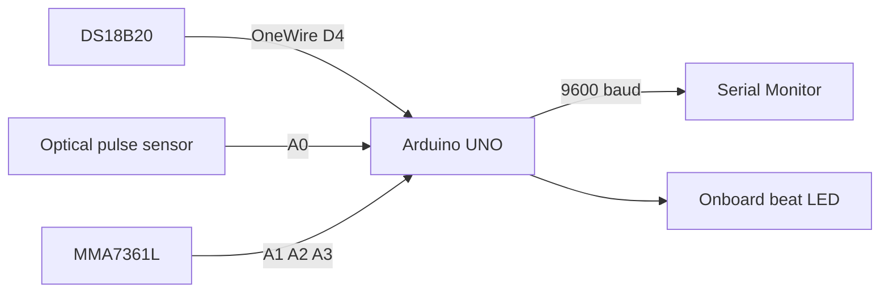

# Low-Cost Multi-Sensor Wearable Monitoring Prototype

An Arduino UNO-based academic prototype integrating a DS18B20 temperature sensor, optical pulse sensor and MMA7361L analog accelerometer. Readings are reported over serial for bench evaluation. This is not a medical device or a validated fall detector.

## Architecture

## Hardware and software

| Device | Signal | Arduino pin |
|---|---|---|
| DS18B20 | OneWire data | D4 |
| Pulse sensor | Analog waveform | A0 |
| MMA7361L | X/Y/Z analog outputs | A1/A2/A3 |
| Onboard LED | Pulse indication | D13 |

See [requirements and wiring](docs/requirements_and_wiring.md) before connecting any hardware. Verify the actual sensor modules and voltage ratings.

## Build and run

1. Install Arduino IDE and Arduino AVR Boards. Select Arduino Uno (ATmega328P), assuming the classic UNO used in the original project.
2. Install OneWire, DallasTemperature and PulseSensor Playground via Library Manager.
3. Open [wearable_monitor.ino](firmware/wearable_monitor/wearable_monitor.ino) and click Verify. A physical board is not required for compilation.
4. For bench testing only, connect the verified hardware, select the serial port, upload and open Serial Monitor at 9600 baud.
5. Follow the [validation plan](docs/validation.md).

## Firmware revision

The revised sketch retains the original pins and pulse threshold of 550. It uses asynchronous temperature conversion and elapsed-time reporting rather than the original fixed one-second delay, checks disconnected/invalid temperature values, removes the arbitrary 60–70 BPM classification, and reports raw accelerometer ADC counts and nominal voltages. The pulse library interrupt configuration precedes its include. See [sensor processing](docs/sensor_processing.md).

## Validation status

The revised firmware has not yet been compiled or hardware-tested. The original code and project documents are historical artifacts, not evidence of successful operation of this revision. Record actual tool versions, compilation output and bench results before marking checks passed.

## Scope

Temperature is the sensor reading, not a validated core body temperature. BPM estimates depend on signal quality; absence of a new beat estimate is not a medical finding. Accelerometer output is uncalibrated; no fall classification, wireless telemetry, medical diagnosis, battery-life measurement or clinical accuracy is claimed. Do not rely on this prototype for health or safety decisions.
