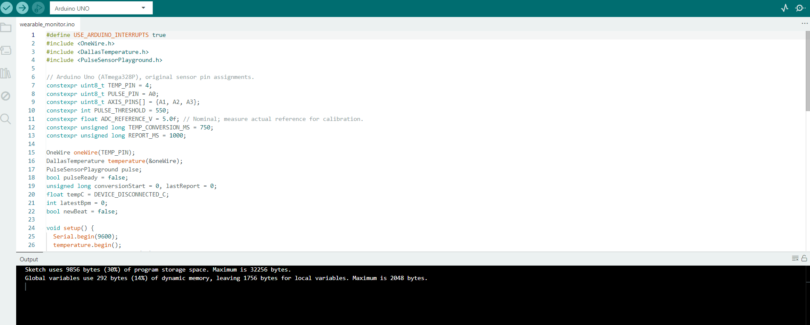

# Software and Hardware Validation

## 1. Objective

Verify firmware compilation, resource utilization, sensor acquisition and serial reporting for the multi-sensor wearable monitoring prototype.

## 2. Compilation Environment

- Development environment: Arduino IDE
- Target board: Arduino UNO
- Microcontroller: ATmega328P
- Required libraries: OneWire, DallasTemperature and PulseSensor Playground

Exact IDE, board core and library versions have not yet been recorded.

## 3. Compilation Results

Compilation completed successfully.

| Resource | Used | Maximum | Remaining |
|---|---:|---:|---:|
| Program storage | 9,856 bytes | 32,256 bytes | 22,400 bytes |
| Static RAM allocation | 292 bytes | 2,048 bytes | 1,756 bytes |

## 4. Validation Matrix

| Test ID | Test Description | Status |
|---|---|---|
| TC-01 | Firmware compilation | Passed |
| TC-02 | Library dependency resolution | Passed |
| TC-03 | Program storage utilization | Passed |
| TC-04 | Static RAM utilization | Passed |
| TC-05 | Temperature measurement | Not run |
| TC-06 | Disconnected temperature sensor | Not run |
| TC-07 | Pulse sensor measurement | Not run |
| TC-08 | Three-axis accelerometer response | Not run |
| TC-09 | Serial output verification | Not run |
| TC-10 | Concurrent sensor scheduling | Not run |

## 5. Engineering Analysis

Program storage utilization is approximately 30.6%, while static RAM utilization is approximately 14.3%.

The firmware fits within the selected microcontroller's available memory resources.

## 6. Limitations

Compilation does not establish physical sensor operation, measurement accuracy, runtime memory safety or clinical performance.

Hardware-level validation, sensor calibration and timing analysis remain necessary.

The system is an experimental monitoring prototype and is not a medical device or validated fall-detection system.

## 7. Conclusion

All four build-related validation checks passed. Six hardware and runtime validation checks remain pending.
